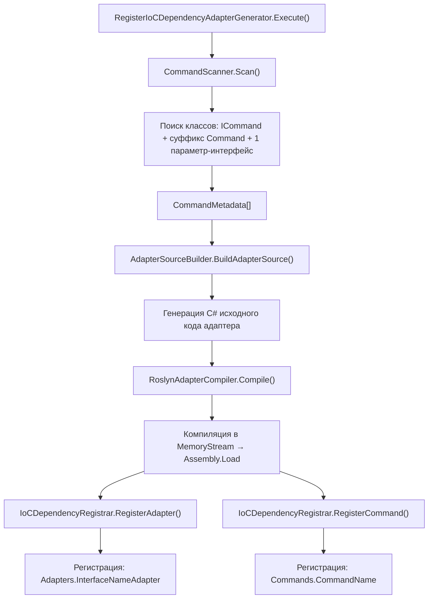

# Генератор адаптеров — Архитектура

## Обзор

Генератор адаптеров автоматически создаёт классы-адаптеры в рантайме через Roslyn, регистрируя их в IoC-контейнере. Это устраняет необходимость вручную писать адаптеры и их IoC-регистрации.

## Как работает



## Структура файлов

| Файл | Назначение |
|------|-----------|
| [`IAdapterGenerator.cs`](file:///home/michael/OOAD/Game/AdapterGenerator/IAdapterGenerator.cs) | Интерфейс генератора |
| [`AdapterGenerator.cs`](file:///home/michael/OOAD/Game/AdapterGenerator/AdapterGenerator.cs) | Оркестратор — координирует все шаги |
| [`ICommandScanner.cs`](file:///home/michael/OOAD/Game/AdapterGenerator/ICommandScanner.cs) | Интерфейс сканера команд |
| [`CommandScanner.cs`](file:///home/michael/OOAD/Game/AdapterGenerator/CommandScanner.cs) | Сканирование сборок через Reflection |
| [`CommandMetadata.cs`](file:///home/michael/OOAD/Game/AdapterGenerator/CommandMetadata.cs) | Метаданные обнаруженной команды |
| [`IAdapterSourceBuilder.cs`](file:///home/michael/OOAD/Game/AdapterGenerator/IAdapterSourceBuilder.cs) | Интерфейс генератора исходного кода |
| [`AdapterSourceBuilder.cs`](file:///home/michael/OOAD/Game/AdapterGenerator/AdapterSourceBuilder.cs) | Генерация C# кода адаптера |
| [`IAdapterCompiler.cs`](file:///home/michael/OOAD/Game/AdapterGenerator/IAdapterCompiler.cs) | Интерфейс компилятора |
| [`RoslynAdapterCompiler.cs`](file:///home/michael/OOAD/Game/AdapterGenerator/RoslynAdapterCompiler.cs) | Компиляция через Roslyn |
| [`IDependencyRegistrar.cs`](file:///home/michael/OOAD/Game/AdapterGenerator/IDependencyRegistrar.cs) | Интерфейс регистратора |
| [`IoCDependencyRegistrar.cs`](file:///home/michael/OOAD/Game/AdapterGenerator/IoCDependencyRegistrar.cs) | Регистрация в IoC через Expression.Lambda |
| [`RegisterIoCDependencyAdapterGenerator.cs`](file:///home/michael/OOAD/Game/IoC/RegisterIoCDependencyAdapterGenerator.cs) | Точка входа — команда ICommand |

## Принципы SOLID

### S — Single Responsibility
Каждый класс отвечает за одну задачу:
- `CommandScanner` — только поиск команд
- `AdapterSourceBuilder` — только генерация кода
- `RoslynAdapterCompiler` — только компиляция
- `IoCDependencyRegistrar` — только регистрация в IoC

### O — Open/Closed
- Новые типы компиляторов (не Roslyn) можно добавить через `IAdapterCompiler`
- Новые стратегии регистрации — через `IDependencyRegistrar`

### L — Liskov Substitution
- Адаптеры создаются через IoC, а не через `new` — замена реализации не требует правок кода
- Стратегии подменяемы через IoC без изменения потребителей

### I — Interface Segregation
- 4 узких интерфейса вместо одного "бога"
- Каждый интерфейс определяет минимальный контракт

### D — Dependency Inversion
- `AdapterGenerator` зависит от интерфейсов, не от реализаций
- `new` только в Composition Root ([`RegisterIoCDependencyAdapterGenerator`](file:///home/michael/OOAD/Game/IoC/RegisterIoCDependencyAdapterGenerator.cs))

## Правила именования

Из справки, реализовано в [`CommandMetadata`](file:///home/michael/OOAD/Game/AdapterGenerator/CommandMetadata.cs):

| Правило | Пример |
|---------|--------|
| Имя зависимости команды | `Commands.Game_MoveCommand` |
| Имя зависимости адаптера | `Adapters.Game_IMovingObjectAdapter` |
| Имя класса адаптера | `Game_IMovingObjectAdapter` |

> [!NOTE]
> Полное имя типа берётся с namespace, точки заменяются на `_`.

## Пример сгенерированного адаптера

Для `IMovingObject` генерируется:

```csharp
using App;
using Game;
using System.Collections.Generic;

public class Game_IMovingObjectAdapter : Game.IMovingObject
{
    private readonly IDictionary<string, object> _item;

    public Game_IMovingObjectAdapter(IDictionary<string, object> item)
    {
        _item = item;
    }

    public Game.Vector Position
    {
        get => Ioc.Resolve<Game.Vector>("Properties.Position", _item);
        set => Ioc.Resolve<ICommand>("Properties.Position.Set", _item, value).Execute();
    }

    public Game.Vector Speed
    {
        get => Ioc.Resolve<Game.Vector>("Properties.Speed", _item);
    }
}
```

> [!IMPORTANT]
> IoC.Resolve не вызывается напрямую в бизнес-коде — вызовы генерируются автоматически и скомпилированы в быстрые делегаты.

## Использование

```csharp
// Запуск генерации при старте приложения
var assemblies = new[] { typeof(MoveCommand).Assembly };
new RegisterIoCDependencyAdapterGenerator(assemblies).Execute();

// После этого можно резолвить команды:
var command = Ioc.Resolve<ICommand>("Commands.Game_MoveCommand", gameObject);
command.Execute();
```

## Тесты

| Файл | Что тестирует |
|------|--------------|
| [`CommandScannerTests.cs`](file:///home/michael/OOAD/Game.Tests/AdapterGenerator/CommandScannerTests.cs) | Поиск команд, фильтрация невалидных |
| [`CommandMetadataTests.cs`](file:///home/michael/OOAD/Game.Tests/AdapterGenerator/CommandMetadataTests.cs) | Правила именования ключей |
| [`AdapterSourceBuilderTests.cs`](file:///home/michael/OOAD/Game.Tests/AdapterGenerator/AdapterSourceBuilderTests.cs) | Корректность генерируемого кода |
| [`AdapterGeneratorIntegrationTests.cs`](file:///home/michael/OOAD/Game.Tests/AdapterGenerator/AdapterGeneratorIntegrationTests.cs) | Полный пайплайн: сканирование → генерация → компиляция → регистрация |
